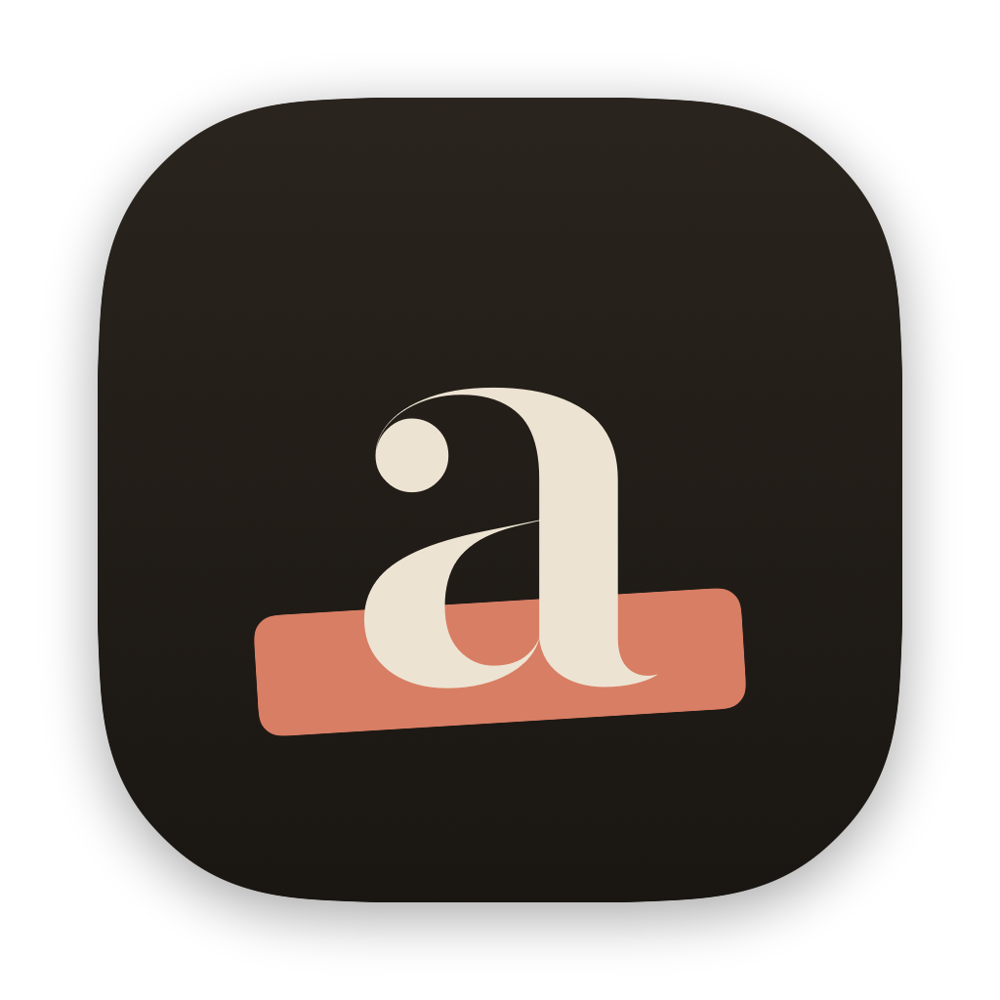
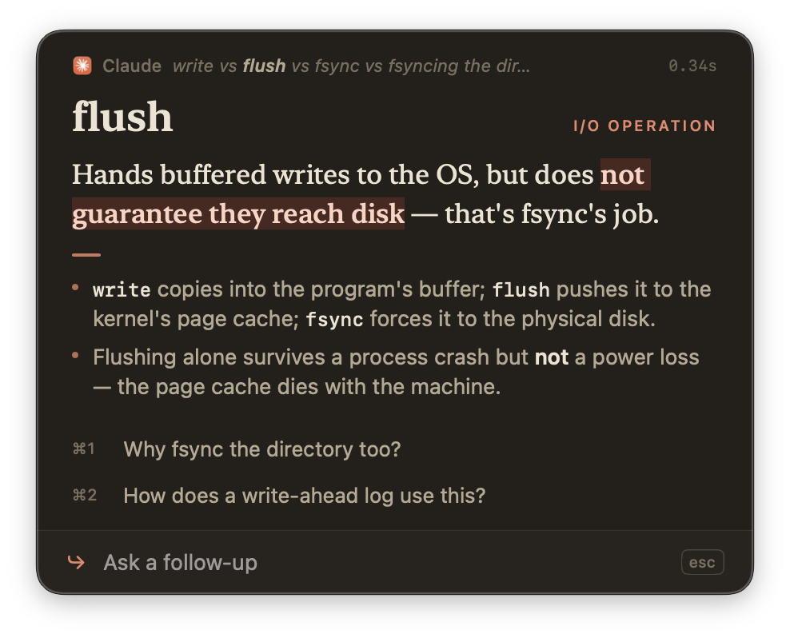
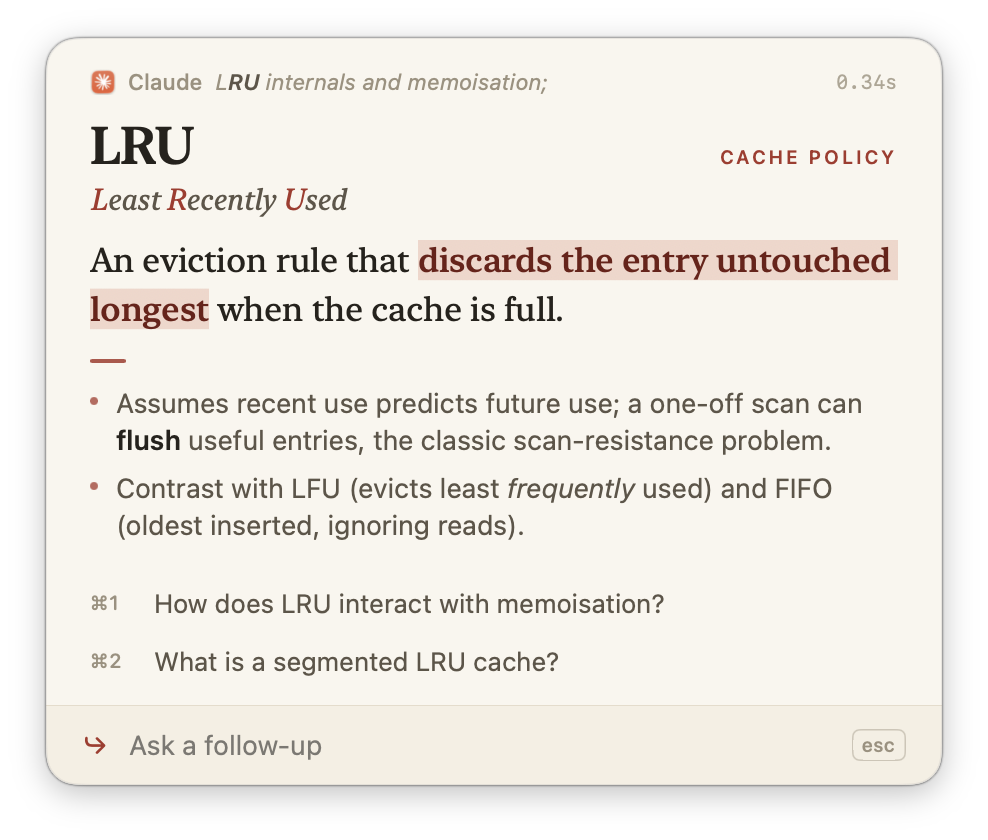
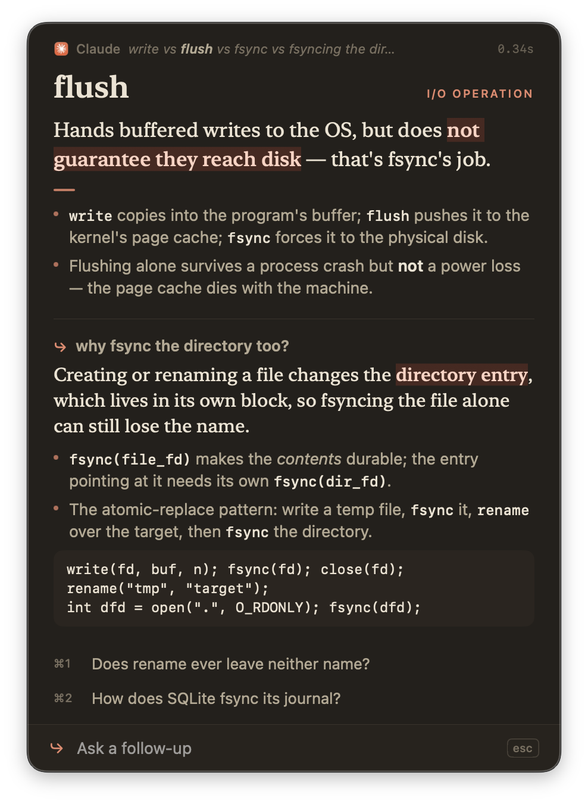
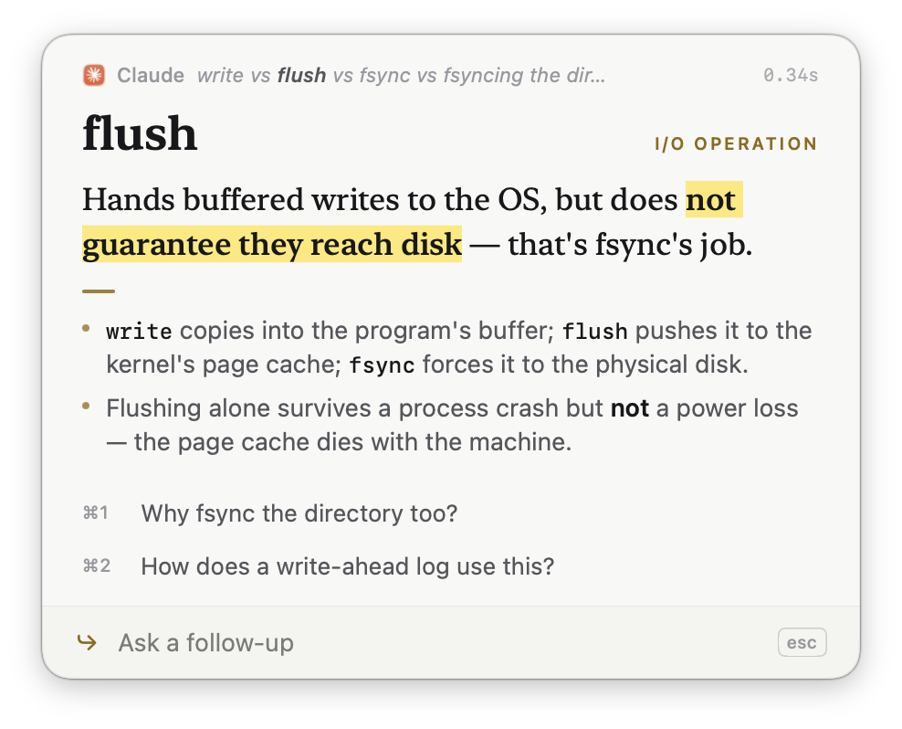
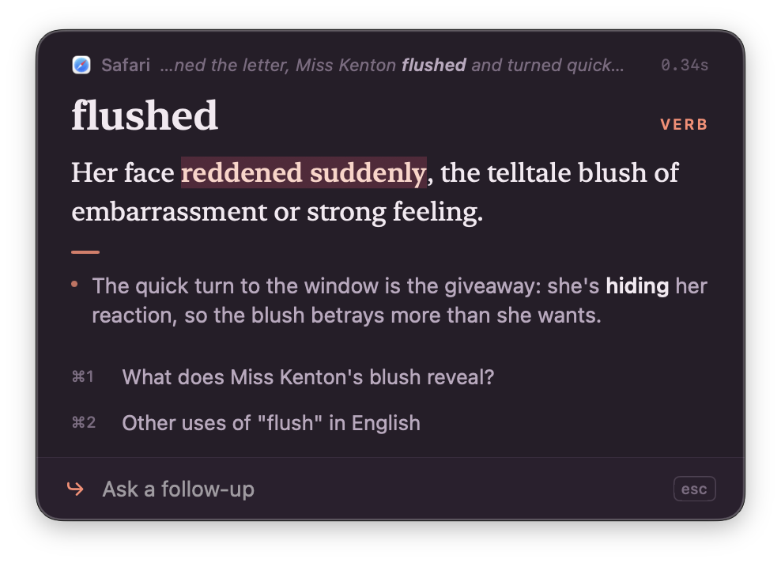

# Aside

**Look anything up on your Mac, in context, in about a third of a second.**

macOS Look Up reads one word, ignores the sentence it sits in and answers from a dictionary. "flush" next to "fsync" gets you blushing and poker hands, "fsync" gets you "did you mean sync?" and "LRU" gets nothing. Aside reads the text around what you point at, answers what it means *there*, and lets you keep asking.



## Use it

- **Select any text** (one word, an acronym, a whole sentence) and press **⌥ Space**.
- **Or don't select anything**: point at a word and press **⌥ Space**. Aside works out the whole term, so pointing at "ahead" in "write-ahead log" explains the write-ahead log.
- **Follow up by typing.** The input is already focused: type and press Return. **⌘1** and **⌘2** ask the suggested follow-ups, and **↓** picks one with the keyboard.
- **Esc** closes it, as does pressing ⌥ Space again on the same text or clicking elsewhere. **⌘C** copies the answer and **⌘P** pins the panel open.

The answer is laid out for skimming: the term and what kind of thing it is here, acronyms spelled out with their initials picked out, a one-sentence meaning with the key phrase highlighted, then a couple of short points that relate it to the words around it.

 

## How it works

- **Fast.** Answers come from DeepSeek V4.1 Flash on Together with thinking turned off. The first word arrives in about 0.3s and the whole answer in under a second. Aside keeps one connection warm and opens it as soon as you hold ⌥, before the shortcut lands. Asking about the same text twice is instant.
- **In context.** Aside reads the selection (or the word under the pointer) through the Accessibility API, plus the paragraphs around it and the app and window it's in. That works in native text views and in web content through WebKit's and Chromium's text markers (tested in TextEdit, Chrome and the Claude app). Where an app hides its text, Aside copies the selection and puts your clipboard back, or reads the screen around the pointer with on-device text recognition. Capture takes 20–70ms.
- **Looks things up when it doesn't know.** For a codename, product, person or anything newer than the model, it doesn't guess. It searches instead, then answers from what it found and shows the sources. Wikipedia needs no key. With a Gemini key, Google Search grounding covers the news too. Ordinary terms never search, and a searched answer takes about two seconds.
- **Private by default.** Only the text you look up and the words around it are sent to the model. When a search is needed, only a short query (like "Anthropic Glasswing") goes to Wikipedia or Gemini. Keys are stored in `~/Library/Application Support/Aside/`, readable only by you.

## Install

**[Download Aside for Mac](https://github.com/joshuaramkissoon/aside/releases/latest/download/Aside.dmg)** (macOS 15.2 or later, Apple silicon and Intel). Open the DMG and drag Aside into Applications. It's signed and notarised, and it updates itself.

The first launch walks you through setup. Grant **Accessibility**, which Aside needs to read what you point at; the window moves on by itself once it sees the switch flipped. **Screen Recording** is optional and only used for apps that hide their text. Then paste a [Together](https://api.together.ai) API key. Unfamiliar names are looked up on Wikipedia with no extra key; a Gemini key in Settings adds Google Search for recent news. The last step has some text to try ⌥ Space on. To reuse keys from an `.env` without pasting them:

```sh
TOGETHER_API_KEY=... ~/Applications/Aside.app/Contents/MacOS/Aside --import-key
```

Settings (in the menu bar) has three palettes (Rubric, Marker, Plum & Coral), each following light and dark mode, a choice of two-key shortcuts, your keys and launch at login. **Pause Aside** in the menu hands ⌥ Space back to other apps until you resume.

 

## Develop

To build from source you need Xcode's command line tools:

```sh
scripts/build.sh --install                   # local build, signed with your Apple Development cert, into ~/Applications
swift build && .build/debug/Aside            # run from a terminal that has Accessibility access
python3 bench/run.py [case ...]              # latency and answers for bench/cases.json, using the app's exact prompt
.build/debug/Aside --shots out/              # panel screenshots in every palette; SHOTS=all adds edge cases, SETTINGS=1 and ONBOARD=1 the windows
PROBE_APP=com.google.Chrome .build/debug/Aside --probe 0   # print what capture reads from an app
.build/debug/Aside --trigger                 # run a look-up in the running app, as if the shortcut was pressed
scripts/icon.sh                              # rebuild the app icon
scripts/release.sh [--publish]               # notarised universal DMG + Sparkle appcast; --publish uploads a GitHub release and redeploys the site
.build/debug/Aside --selftest                # check capture on Aside's own window, and CJK word segmentation
.build/debug/Aside --markdown                # print how the parser reads tricky markdown
```

The prompt lives in `Sources/Aside/Prompt.swift`; `bench/run.py` reads it from there, so the bench and the app never drift apart.

## Licence

MIT.
